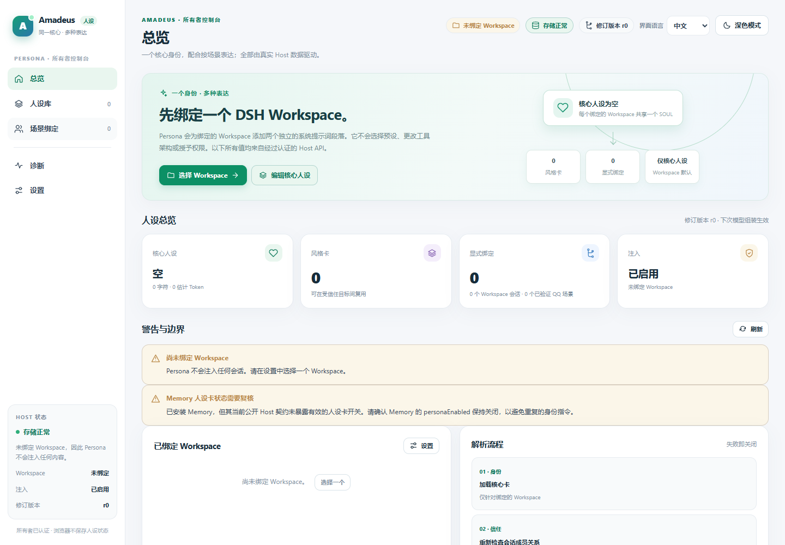

# Amadeus Persona

[English](README.md) · [详细配置参考](REFERENCE.md)

以独立系统提示词段落注入统一核心身份与多套场景风格。

目标发行包：**`@fg-lab/amadeus-persona@1.2.0`**。已验证的官方 DSH Desktop 基线：**0.2.1-rc.3**。许可证：MIT。

## 当前发行状态

目前是产品化候选。正式 npm 与 GitHub Release 发布仍需通过发布门禁并完成 npm 账户授权；这里的版本号不代表已经公开发行。

## 能帮你做什么

- 编辑一份共享 SOUL 核心身份和任意数量的 STYLE 风格卡，保留版本与备份。
- 为一个工作区选择默认风格，再覆盖普通会话或可信 QQ 场景，也可选择继承、仅核心或禁用。
- 在后续模型组装时更新人格，不切换 Agent Preset、不重建既有会话，也不中断正在进行的工具调用。
- 使用中英文控制台的人格库、场景绑定与诊断，检查冲突和最终系统提示词可见性。

示例：同一个项目保持统一核心身份，在工作会话中使用简洁风格，在授权 QQ 群中使用聊天风格。群内成员共用该场景风格，不共享其他场景的私有记忆。

Persona 不创建新模型、不授予工具权限。默认排除其他工作区与子代理。人格修改可能影响请求系列或提示词缓存，长对话历史也可能影响表达；配置了人格不等于最终注入成功，应查看诊断。

## 安装与首次配置

使用官方 DSH 插件管理器将预构建 `.tgz` 安装到所需 Profile，无需手工构建源码。按[安装说明](docs/INSTALL_V1_2.md)操作，不要手工改写正在运行的 Profile。

打开人格控制台、绑定一个工作区、保存自己的核心人格，再按需建立风格与绑定。空白安装不会强加人格。

其他 Amadeus 插件均为可选联动，按需要分别安装。

## 界面

截图展示已有界面，不表示本轮所有真实平台能力均已通过。具体限制请阅读配置参考和验收报告。

## 升级与回滚

升级前备份用户数据。程序、持久数据和恢复备份分开保存。禁用停止功能；卸载默认保留外部数据。回退旧程序不能自动撤销数据库迁移。

- [升级政策](docs/UPGRADE_POLICY.md)
- [数据迁移与恢复](docs/DATA_MIGRATION.md)
- [发行检查清单](docs/RELEASE_CHECKLIST.md)
- [完整配置与限制](REFERENCE.md)

[项目主页](https://github.com/jeskoky-pixel/Amadeus-dsh) · [MIT 许可证](LICENSE)
